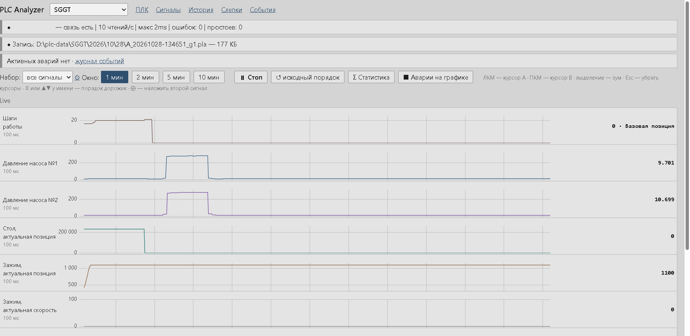
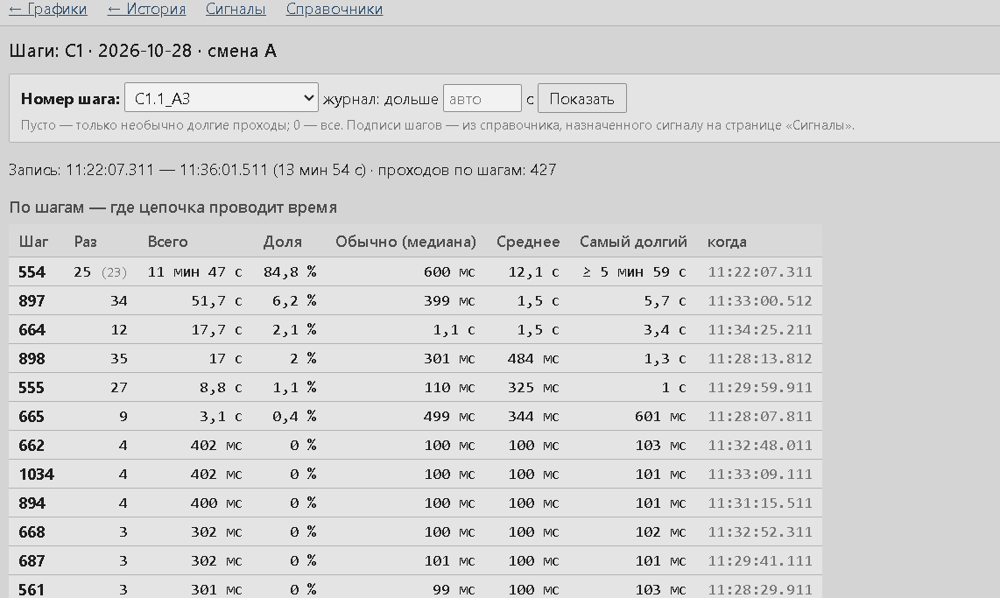
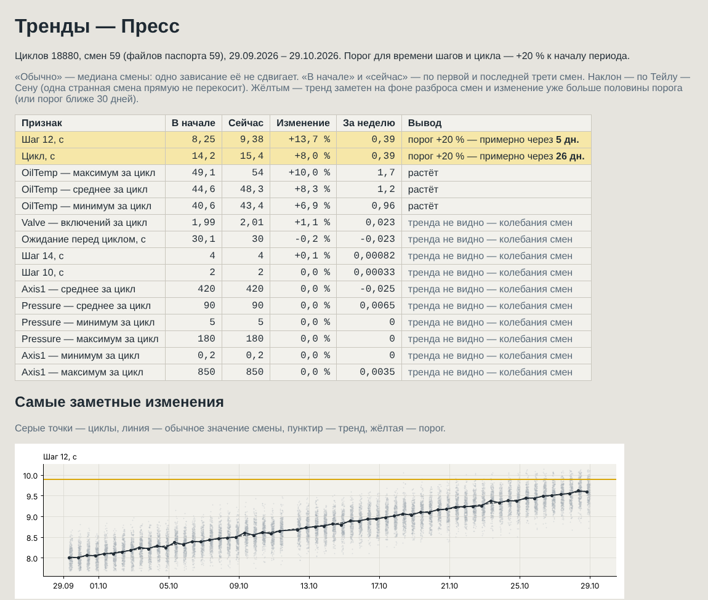
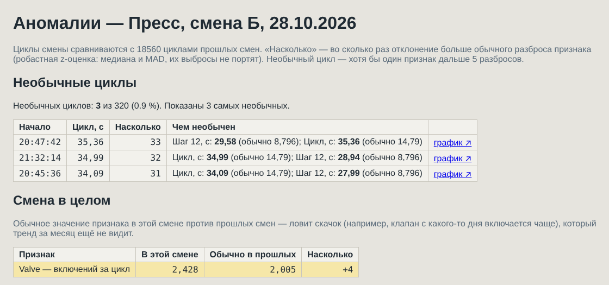

# PLC Analyzer

Сбор, запись и анализ данных с контроллеров **Siemens S7** — круглосуточно, с просмотром в браузере
с любого ПК цеха. Написан на **Go**, собирается в один `.exe` без установки.

> *A data-acquisition and analysis tool for Siemens S7 PLCs, written in Go: polls the PLC over S7comm,
> records shift files, shows live and historical trends in the browser, logs alarms, analyses
> step chains and machine cycles, and keeps a per-cycle "health passport" for predictive maintenance
> (trends and anomaly detection in Python). Runs as a Windows service; single binary, no installer,
> read-only access to the PLC.*



## Зачем

Когда станок останавливается, важно не только *что* случилось, но и *что было перед этим*:
какое давление, какой шаг цепочки, какой датчик не пришёл. Штатные средства показывают текущее
состояние, а заводские аналайзеры привязаны к одному ПК и одному пользователю.

PLC Analyzer пишет данные с ПЛК постоянно, сам ловит аварии и сохраняет участок записи вокруг них,
а смотреть и разбирать всё это можно в браузере — дежурному со своего ПК, инженеру — у себя.

## Возможности

**Сбор данных**
- Несколько ПЛК одновременно; ПЛК и сигналы добавляются в интерфейсе, без правки кода
- Опрос по S7comm (S7-300/1200/1500): адрес строкой `DB11.DBW90`, `DB5.DBX3.1`, типы BOOL…REAL, масштаб и единицы
- Своя частота у каждого сигнала; соседние адреса автоматически склеиваются в один запрос, одно соединение на ПЛК
- Изменения сигналов применяются на лету — без перезапуска и без обрыва записи
- Переподключение после обрыва связи; панель состояния связи и записи
- **Только чтение**: программа ничего не пишет в ПЛК

**Запись и просмотр**
- Запись по сменам (А 08–20, Б 20–08) в собственный формат: сжатие, контрольные суммы, оборванный файл читается до целой части
- Хранение N дней, старые смены удаляются сами
- **Live**: окно 1–10 минут, стоп-кадр, зум, курсоры A/B с Δt, наложение второго сигнала на дорожку
- **История**: любой участок любой смены; прореживание для обзора без потери пиков, при зуме — все точки
- **Наборы сигналов** («окна графиков»): «Гидравлика», «Стол»… — у каждой вкладки или монитора свой набор
- Выгрузка участка в PNG (для отчёта) и CSV (под русский Excel); **слепки** — сохранённые случаи с категорией и комментарием

**Аварии и события**
- Аварии и предупреждения по биту или по коду ошибки (INT/WORD/DINT: не 0 — авария)
- Нормы аналоговых сигналов: границы, зона возврата, скачок «больше X за T мс»
- Журнал событий, панель активных аварий, шунтирование долго висящих аварий
- **Автослепок по аварии**: 5 минут до и 2 после, один на «лавину» аварий
- Справочники «число → текст»: коды ошибок и номера шагов показываются словами

**Анализ**
- Статистика по участку: мин / макс / среднее, число включений битов, самое долгое «1» — по всем точкам, а не по прореженным
- **Журнал шаговой цепочки**: сколько цепочка стоит в каждом шаге за смену (медиана, максимум, доля смены) и какие проходы необычно долгие
- **Режим работы**: время по режимам, шаги и циклы — только в автомате
- **Циклы**: от выхода из исходного шага до возврата в него — обычное время цикла, ожидание между циклами, самые долгие циклы с затянувшимся шагом, график по ходу смены, гистограмма, тренд «в начале / в конце смены»; у каждой строки — «график ↗» на этот участок записи



**Предиктивный анализ** (подробнее — [ниже](#паспорт-циклов-и-предиктивный-анализ))
- **Паспорт здоровья циклов**: служба по каждой смене записывает признаки каждого цикла — время шагов, мин/макс/среднее давления, температуры, положений, число включений битов. Записи живут 30 дней, паспорта — всегда
- **Тренды**: что медленно меняется от смены к смене и через сколько дней время шага или цикла дойдёт до порога
- **Аномалии**: какие циклы последней смены непохожи на обычные — чем именно и ссылка на график; сдвиг смены в целом

**Эксплуатация**
- Служба Windows: автозапуск, перезапуск после сбоя, лог в файл с ротацией
- Доступ из сети цеха: **смотреть — всем, менять настройки — только с разрешённых адресов** (проверка на сервере)
- Второй экземпляр не запускается: два анализатора не будут писать одни и те же файлы
- Интерфейс по принципам **ISA-101** (High Performance HMI): норма — серым, цвет только для отклонений

## Быстрый старт

Нужен [Go](https://go.dev/dl/) (версия — в `go.mod`). CGO и компилятор C не нужны.

```powershell
git clone https://github.com/KudinovArtemilus/plc-analyzer.git
cd plc-analyzer
go build -o plc-analyzer.exe .
.\plc-analyzer.exe
```

Откройте <http://127.0.0.1:8080>. При первом запуске создаётся база с примером ПЛК —
укажите свой адрес на странице «ПЛК», затем добавьте сигналы на странице «Сигналы».

**Что нужно в ПЛК** (S7-1200/1500, в TIA Portal):
- в свойствах CPU: *Защита и безопасность → Механизмы подключения → Разрешить доступ PUT/GET*;
- у DB, которые читаются: снять галочку *Оптимизированный доступ к блоку* (нужны абсолютные адреса).

S7-300 читается без дополнительных настроек.

## Служба Windows

Для постоянной работы — службой: запускается вместе с Windows (отложенно, когда поднята сеть),
перезапускается после сбоя. Команды — в PowerShell **от имени администратора**:

```powershell
.\plc-analyzer.exe install -addr :8080     # параметры запоминаются в настройках службы
.\plc-analyzer.exe start
.\plc-analyzer.exe status
.\plc-analyzer.exe stop
.\plc-analyzer.exe uninstall               # база, лог и записи остаются
```

Служба запускает `.exe` из той папки, где он лежал при `install`, поэтому для работы удобно держать
отдельную папку (например `D:\plc-analyzer\` с `plc-analyzer.exe` и `analyzer.db`), а не папку с исходниками.
Обновление: `stop` → скопировать новый `.exe` → `start`; миграции базы выполняются сами.

## Паспорт циклов и предиктивный анализ

Износ гидравлики, насоса, направляющих идёт неделями — по одной смене его не видно. Поэтому из каждого
цикла выжимаются **признаки**, которые меняются при износе, и хранятся всегда (сотни КБ в месяц),
а по ним Python ищет тренды и аномалии.

**Настройка — один раз на ПЛК.** «История» → смена в автомате → «шаги» → выбрать сигнал шага,
режим и его значение «автомат», проверить исходный шаг в разделе «Циклы» → **«Сохранить для паспорта»**.
Дальше служба раз в 10 минут считает паспорта законченных смен (при первом запуске — всех, что на диске),
а при смене настройки пересчитывает их сама.

```
D:\plc-data\Пресс\2026\10\28\A_20261028-080000_g1.pla            — запись (удаляется через -keep дней)
D:\plc-data\Пресс\passport\2026\10\28\A_20261028-080000_g1.csv   — паспорт: строка на цикл (хранится всегда)
```

Столбцы паспорта: `cycle_s`, `idle_s`, `step_N_s` (время каждого шага), `<сигнал>.min/.max/.mean`,
`<бит>.on` (включений за цикл). Формат — `;` и десятичная запятая: открывается в Excel,
в Python — `pd.read_csv(path, sep=";", decimal=",")`.

**Тренды и аномалии** — ссылки вверху «Истории»; анализатор запускает скрипты из `scripts\` и открывает отчёт.

| Скрипт | Что показывает | Как считает |
|---|---|---|
| `trend.py` | что медленно меняется; «порог +20 % — через N дней» | медиана смены, наклон по Тейлу — Сену, тренд «заметен» только на фоне разброса смен |
| `anomaly.py` | необычные циклы последней смены и чем; сдвиг смены в целом | робастная z-оценка (медиана и MAD) против прошлых смен |





*На скриншотах — учебные данные из `scripts/demo_passports.py`: месяц паспортов с заложенным износом оси.*

**Python** нужен только для трендов и аномалий (сбор, запись и всё остальное работают без него).
Анализатор берёт Python из параметра `-python`, иначе — `scripts\.venv\Scripts\python.exe` рядом с собой, иначе — `python` из PATH:

```powershell
cd D:\plc-analyzer\scripts          # папка scripts рядом с plc-analyzer.exe
python -m venv .venv
.venv\Scripts\python.exe -m pip install -r requirements.txt
```

Скрипты можно запускать и сами — например, на копии паспортов у себя:

```powershell
python trend.py   D:\plc-data\Пресс D:\plc-data\explore\trend
python anomaly.py D:\plc-data\Пресс D:\plc-data\explore\anomaly --plc 1 --step "Шаги" --mode "Режим"
python demo_passports.py D:\plc-data\demo   # учебные паспорта, чтобы попробовать без истории
```

## Параметры запуска

| Параметр | По умолчанию | Что задаёт |
|---|---|---|
| `-addr` | `127.0.0.1:8080` | адрес веб-сервера; `:8080` — доступ из сети цеха |
| `-admin` | — | с каких адресов, кроме этого ПК, можно менять настройки: `10.0.0.5,10.0.0.6` |
| `-db` | `analyzer.db` | база настроек: ПЛК, сигналы, нормы, справочники, наборы, журнал событий |
| `-data` | `D:\plc-data` | папка записей смен |
| `-keep` | `30` | сколько дней хранить записи |
| `-log` | `plc-analyzer.log` в папке `-data` | файл лога; `-` — только консоль |
| `-scripts` | `scripts` | папка скриптов анализа (`trend.py`, `anomaly.py`); у службы — рядом с `.exe` |
| `-python` | `scripts\.venv\Scripts\python.exe`, иначе `python` | Python для трендов и аномалий |

Справка: `plc-analyzer.exe -h`.

## Доступ из сети и безопасность

- **ПЛК — только чтение.** Программа не выполняет ни одной записи в контроллер.
- **Смотреть может любой ПК**, который достучался до анализатора; **менять настройки** — только этот ПК
  и адреса из `-admin`. Проверка на сервере: у остальных кнопки правки скрыты, а запрос на изменение отклоняется.
- Для доступа из сети откройте порт в брандмауэре Windows:
  ```powershell
  netsh advfirewall firewall add rule name="PLC Analyzer 8080" dir=in action=allow protocol=TCP localport=8080 profile=domain,private
  ```
- Данные никуда не отправляются: база, записи и лог лежат только на диске анализатора.

## Как устроено

```
ПЛК ──S7comm──► plc (опрос блоками) ──► buffer (кольцо 10 мин) ──► Live (SSE)
                        │
                        ├──► archive (файлы смен .pla) ──► История, слепки, статистика, шаги, циклы
                        │          └──► passport (признаки каждого цикла, .csv) ──► scripts: тренды, аномалии (Python)
                        └──► events (фронты аварий, нормы) ──► журнал событий, панель аварий
```

| Пакет | Что делает |
|---|---|
| `internal/plc` | адреса S7, группировка сигналов в блоки, опрос по S7comm |
| `internal/buffer` | кольцевой буфер последних 10 минут для Live |
| `internal/archive` | формат файлов смен: запись, чтение, смены, очистка, прореживание |
| `internal/events` | детекторы аварий (бит, код ошибки) и норм аналоговых сигналов |
| `internal/stats` | статистика по участку записи |
| `internal/steps` | журнал шаговой цепочки и сводка по шагам |
| `internal/cycles` | циклы по журналу шагов: длительность, ожидание, затянувшийся шаг, тренд, гистограмма |
| `internal/passport` | паспорт циклов: признаки каждого цикла, CSV, пересчёт законченных смен |
| `internal/store` | база настроек SQLite и миграции схемы |
| `internal/web` | веб-интерфейс: HTTP, шаблоны, статика (встроена через `embed`) |
| `scripts` | Python: чтение `.pla` (`pla.py`), отчёт по смене, тренды и аномалии по паспортам |

**Технологии:** Go · SQLite ([modernc.org/sqlite](https://modernc.org/sqlite), без CGO) ·
[gos7](https://github.com/robinson/gos7) · `html/template` · [HTMX](https://htmx.org) ·
[uPlot](https://github.com/leeoniya/uPlot) · Server-Sent Events · `golang.org/x/sys/windows/svc` ·
Python ([pandas](https://pandas.pydata.org), [matplotlib](https://matplotlib.org)) для предиктивного анализа.

Логика анализа (пакеты `events`, `stats`, `steps`, `cycles`, `passport`) не знает ни о ПЛК, ни о файлах, ни о вебе:
на вход — время и значения, на выход — результат. Поэтому она проверяется тестами без оборудования.

## Разработка

```powershell
go vet ./...
go test ./...
```

Для проверки изменений рядом с работающей службой запускайте отдельный экземпляр со своей базой
и папкой данных, на другом порту:

```powershell
.\plc-analyzer.exe -addr 127.0.0.1:8081 -db analyzer-dev.db -data D:\plc-data-dev
```

HTML-шаблоны (`internal/web/templates`) содержат действия Go `{{ … }}`: автоформатирование HTML
может их испортить, поэтому в `.vscode/settings.json` оно отключено.

## Планы

- «Шаг висит дольше обычного» и «цикл дольше нормы» — предупреждения на лету, нормы — из паспорта
- Паспорт по нескольким значениям режима (автомат + полуавтомат); прогноз отказа по журналу аварий, когда накопится история
- Поиск циклов по битам и аналоговым сигналам (автокорреляция) для оборудования без шаговой цепочки
- Тип соединения S7 (PG / OP / Basic) для каждого ПЛК
- Другие контроллеры (Beckhoff ADS)

## Автор

Артём Кудинов — инженер АСУП. [github.com/KudinovArtemilus](https://github.com/KudinovArtemilus)